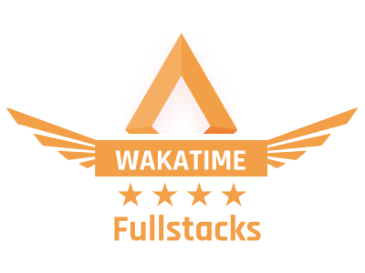

  

Fullstacks community Wakatime leaderboard API and tools.

## WakaTime access token

1. Create an app at <https://wakatime.com/apps>. Add `https://wakatime.com/oauth/test` to its
   authorized redirect URLs, so WakaTime shows you the code directly.
2. Run `pnpm run wakatime:token` and follow the prompts. It prints an authorize URL, asks for the
   code, exchanges it for a token and can write `WAKATIME_ACCESS_TOKEN` to `.env` for you.

The script reads `WAKATIME_CLIENT_ID`, `WAKATIME_CLIENT_SECRET` and (optionally)
`WAKATIME_REDIRECT_URI` from `.env` (or the environment) and only prompts for the ones that are
missing.

## Repository structure

## Contributing

Development of this project happens in GitHub, and we appreciate contributions. Please read section
bellow before start contributing.

### Prerequisite

- [POSIX-compliant shell][shell]
- [git][git] >= 2
- [volta][volta]
- [node][nodejs] >= 22
- [npm][npm] >= 7

### Branch Organization

- `main`: latest stable release
- `dev`: latest development changes

### Sending a Pull Request

The Fullstacks-Dev team is monitoring for pull requests. We will review your pull request and either
merge it, request changes to it, or close it with an explanation.

Before submitting a pull request, please make sure the following is done:

- Fork the repository and create your feature branch from dev brach.
- Install dependencies by running `pnpm install`.
- To start development run `pnpm run dev:bot` or `pnpm run dev:api`.
- If you’ve fixed a bug or added code that should be tested, add tests please.
- Ensure everything is ok by running `pnpm run lint`.

## Get in Touch

- [Telegram][telegram-channel]
- [Discord][discord-server]

[git]: https://git-scm.com/
[github-cli]: https://cli.github.com/
[nodejs]: https://nodejs.org/en/
[shell]: https://en.wikipedia.org/wiki/Unix_shell
[volta]: https://volta.sh/
[npm]: https://www.npmjs.com/
[telegram-channel]: https://t.me/fullstacks
[discord-server]: https://kutt.it/fsk-discord
